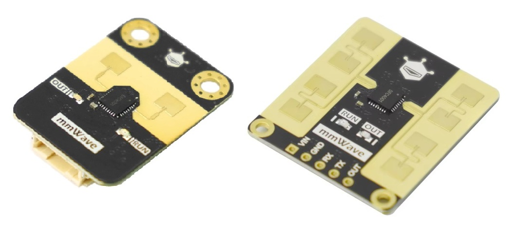

## Arduino Library for DFRobot C4001 mmWave Presence Sensors 

This library supports UART (RX/TX) communications only, using DFRobot's command-line style ASCII protocol. I2C is not supported.

It can use `SoftwareSerial` or `HardwareSerial` (via a `Stream` pointer), with baud rates of 4800 to 115200. The default baud rate is 9600, but you can reconfigure that up to 115200 baud (see example sketch).

It works for these two DFRobot modules, which run on 3.3V or 5V,
* SKU **SEN0609**, C4001 mmWave, 25m, UART only
* SKU **SEN0610**, C4001 mmWave, 12m, UART or I2C (switch selectable), this library only supports UART

Other DFRobot modules use different RX/TX protocols (ASCII or binary). This library will not work with those.




Both these DFRobot boards use the ICLegend S3KM1110 mmWave sensor. This is a system-on-a-chip (SoC) device which has been programmed by DFRobot to support their proprietary ASCII protocol.

There are two on-board LEDs. The green LED means it's in RUN mode. The white LED follows the state of the OUT pin (presence or motion detected). 

I like these boards because they are relatively easy to configure. They do not need a PC application to set them up.

They are often called '_Human_ Presence Sensors'. But I suspect they will also detect space aliens, dogs, cats, robots, drones, Triffids, Tarantulas, etc.

The mmWave sensors use _Frequency Modulated Continuous Wave_ (FMCW) modulation. They emit a series of continuous wave signals with gradually changing frequencies and simultaneously receive the reflected signals. Measurements of distance, velocity and angle are determined by analyzing the reflected signals.

Since they use a kind of radar, they can easily see through a plastic protective cover. They can even see through thin partitions and walls, so take this into account when configuring the sensitivity and range so they don't detect people in adjoining rooms.

> [!NOTE]
> The smaller 12m range board (SEN0610) has a switch on the back to select I2C or UART communications. This must be switched to UART mode. The larger 25m range board (SEN0609) has only UART mode.


## Operating Modes

**Stop and Run**

When the sensor is in Stop mode, it waits for command messages from the master on its RX line before returning a response. Commands cannot be sent unless it is in Stop. The `sensorStop()` command puts it into Stop mode.

When the sensor is in Run mode, it continuously sends _report messages_ to the master on its TX line. This is called _active data reporting_. Use `setRunApp(C4001Mode detectionMode)` or `sensorStart()` to put the sensor into Run mode.


**Detection mode: Presence Detection or Motion Detection**

The detection mode is selected with the `setRunApp(C4001Mode detectionMode)` method. 

_Presence detection_ just returns a boolean value meaning 'presence' or 'no presence' in a "$DFHPD ..." message. Note that the data sheet sometimes uses _existence detection_ instead of _presence detection_.

_Motion detection_ returns much more detailed information in a "$DFDMD ..." message - the number of moving targets detected, the distance, speed and energy. The 'target energy' is not described in the documentation, it seems to be a relative value which could be used to determine the size of the moving object or person.

> [!NOTE]
> For the 25m version, the data sheet states, "a presence detection range of 16 meters, and a motion detection and distance measurement range of 25 meters". This means that beyond 16m the 25m version works only for motion detection. Both presence and motion detection work up to 16m, and motion detection works only between 16 and 25m. \
> \
> **So it may be better to keep the sensor in _motion detection_ mode and use motion to detect presence, maintaining your own 'presence' state with a timeout if no motion is detected after a certain period.**


When in Run, report messages are sent continuously to the master. These should be polled from `loop()` by calling `C4001::receive()`. Received ASCII messages are then parsed with `parseDFHPD()` or `parseDFDMD()` to return individual values.

```cpp
void loop() 
{
    // active reporting message received?
    if (c4001.receive(NULL)) {

        // Motion Detection message received
        if (strncmp(c4001.getRxBuf(), "$DFDMD", 6) == 0) {
            uint numTargets;	// always 0 or 1?
            float targetDistance, targetSpeed, targetEnergy;
            c4001.parseDFDMD(&numTargets, &targetDistance, &targetSpeed, &targetEnergy);
            //TODO add your own presence detection code here
        }

        // Presence Detection message received
        else if (strncmp(c4001.getRxBuf(), "$DFDPD", 6) == 0) {
            bool presenceDetected;
            c4001.parseDFHPD(&presenceDetected);
        }
    }
}

```


## Flash Memory for Storing the Configuration

It is not necessary to configure the chip every time it starts up. Once a suitable configuration has been tested, it can be programmed into Flash memory so it is restored automatically when the chip powers up. To store the current configuration, which includes the baud rate (if changed), call `saveConfig()`.

Once configured, you don't need to poll for _active data reporting_ messages to detect a presence or motion (unless you need the motion detection details). You can just examine the state of the OUT Pin. 

> [!NOTE]
> The OUT pin is NOT an open drain output, so if using more than one sensor you need a separate input for each one. You cannot connect several OUT pins to one microcontroller input.

If the configuration has been saved to Flash, then you don't even need to connect the RX and TX pins.

After calling `saveConfig()`, you must send either the command to start the module `sensorStart()`, or send the reset/restart command `resetSystem()`, or power it off and on. The newly configured parameters will take effect only after these steps.


## Changing the UART Baud Rate

The baud rate can be changed, but the DFRobot library does not help you. It says "the baud rate cannot be changed" (see `motionDetection.ino`, line 30).

The _mumanchu_ example sketch contains a function called `changeBaudRate(ulong newBaudRate)` which will do this for you and save the new baud rate in Flash memory.

After `changeBaudRate()` has been run, you must modify the `Serial1` baud rate in `Serial1.begin(xxx)` so the new baud rate will be used.

To change it back to the default, just call `changeBaudRate(9600)`.

> [!NOTE]
> The data sheet says the default baud rate is 115200 bps. This was not the case for my two boards, they were both configured for 9600 bps. 


## Advantages of This Library

* Uses `Stream` for reading and writing data, so the same code works for both `HardwareSerial` and `SoftwareSerial`.

* Has its own optimised floating point conversion routines to/from character arrays, in `FloatUtils.cpp`.

* Does not use the `String` class and string concatenation. `String` uses `malloc()` and `free()` copiously. This is not good practice because memory fragmentation can occur in devices with small RAM, and it will silently and randomly crash if this happens. 

* Full communications error detection, with timeouts. Every method returns `true` (success) or `false` (failed).

* Debug output is enabled/disabled with `#define DEBUG`, using the `C4001_LOGERROR(s)` and `C4001_PRINT(s)` macros.

* Has a state machine for processing UART messages received from the mmWave board. This detects corrupted messages, and works if reading starts in the middle of a message.

* The example sketch shows how to change the baud rate and save it to Flash memory, see `changeBaudRate(ulong newBaudRate)`.

* Has useful descriptions of each method, to help understand what it does, and why.

* Efficient code. This library does not repeat the same code in multiple methods, which cannot be optimised by the compiler. The DFRobot library contains both UART and I2C code, even if you don't use I2C. See DFRobot's `uartI2CFlag`. This is strange because they could have put this into the `DFRobot_C4001_I2C` class and done all the shared work in a base class.

* The DFRobot library uses a lot of delays instead of parsing the responses in real time. It delays until the response "should have been received" before processing it. These delays may not work for slow baud rates. The _mumanchu_ library parses responses in real time, so no delays are needed and all errors are detected.

* Advantage or Disadvantage? This library supports only the UART protocol, I2C (for the SEN0610 only) is not supported. I'm not sure why you would need to use I2C, because communications speed is not an issue.


## Class Reference

For details of each method, see the comments in the source code, [C4001mmWave.h](src/C4001mmWave.h).  


```cpp
class C4001mmWave
{
public:

    // Sensor operating modes for setRunApp()
    enum C4001Mode : uint
    {
        PresenceDetectionMode = 0,  // returns $DFHPD messages
        MotionDetectionMode = 1     // returns $DPDMD messages
    };

    bool begin(Stream* serial);

    // Reading Data
    bool parseDFHPD(bool* presenceDetected);
    bool parseDFDMD(uint* numTargets, float* targetDistance, 
        float* targetSpeed, float* targetEnergy);
    bool getHWV(char* hwVersion);
    bool getSWV(char* swVersion);

    // Control
    bool setRunApp(C4001Mode detectionMode);
    bool sensorStop();
    bool sensorStart(bool keepState = false);
    bool saveConfig();
    bool resetCfg();
    bool resetSystem();

    // Configuration
    bool setRange(float minMetres, float maxMetres);
    bool getRange(float* minMetres, float* maxMetres);
    bool setTrigRange(float rangeInMetres);
    bool getTrigRange(float* rangeInMetres);
    bool getSensitivity(uint* holdSensitivity, uint* trigSensitivity);
    bool setSensitivity(uint holdSensitivity, uint trigSensitivity);
    bool setLatency(float confirmationLatency, float disappearanceLatency);
    bool getLatency(float* confirmationLatency, float* disappearanceLatency);
    bool setInhibit(float seconds);
    bool getInhibit(float* seconds);
    bool setUart(ulong baudRate);
    bool getUart(ulong* baudRate);
    bool setMicroMotion(bool enabled);
    bool getMicroMotion(bool* enabled);
    bool setThresholdFactor(uint factor);
    bool getThresholdFactor(uint* factor);

    // These do not work on my boards, but they are in the DFRobot library
    #if 0
    bool setGpioMode(bool mode);        // setIoPolaity()
    bool getGpioMode(bool* mode);       // getIoPolaity()
    bool setPwm(uint pwm1, uint pwm2, uint timer);
    bool getPwm(uint* pwm1, uint* pwm2, uint* timer);
    #endif

    char* getRxBuf() { return rxBuf; }
    bool receive(const char* messageSent);
};
```

## Example Sketch

[C4001mmWave-Example.ino](examples/C4001mmWave-Example/C4001mmWave-Example.ino)

You will need two Serial ports, `Serial1` for connecting the mmWave device, and the default `Serial` for the Serial Monitor so you can see the data. 

The mmWave board works with 3.3V or 5V. If your MCU is 5V, connect 5V to the mmWave board's VIN pin. If the MCU is 3.3V, connect 3.3V to VIN. Connect GND to GND.

Some MCUs, like the Arduino Uno, do not support more than one hardware serial port, so you must use `SoftwareSerial` for `Serial1`, as shown in the example sketch. You will need to include the `SoftwareSerial` platform library.

Connect the MCU's `Serial1` TX pin to the mmWave board's RX pin, and connect the MCU's RX to the mmWave's TX pin. The comments in the example sketch show the most common `Serial1` pin numbers, according to your MCU. If you have problems, use `SoftwareSerial Serial1(rxPin, txPin)` channel which can usually use any GPIO pins. Note that `SoftwareSerial` may not work reliably over 38400 Baud.

Parts of the example sketch can be modified or enabled to do different things, see the `#if` statements.

* The definition of the `Serial1` port for the mmWave sensor depends on your MCU and architecture. The example sketch contains definitions for some common MCUs. If in doubt, use `SoftwareSerial Serial1(rxPin, txPin)`.
* The code to change the baud rate can be enabled. It's disabled by default.
* The code to configure it for Presence Detection or Motion Detection can be selected. The default is Motion Detection.
* The code to save the new configuration to Flash can be enabled. It's disabled by default.


## References

UART ASCII Protocol Document (in two places, in case one returns a 404)\
https://dfimg.dfrobot.com/wiki/20522/SEN0609_gravity-c4001-24ghz-mmwave-human-presence-detection-sensor_datasheet_V1.pdf
https://dfimg.dfrobot.com/5ea64bf6cf1d8c7738ad2881/wiki/3b88a4ecd7d7f18918a0fa8ba1f970c6.pdf

Iclegend S3KM1110 Data Sheet \
_I could not find one!_

DFRobot Wiki \
https://wiki.dfrobot.com/sen0609/ \
https://wiki.dfrobot.com/sen0610/

DFRobot Official Library \
https://github.com/cdjq/DFRobot_C4001


## Revision History

| Date       | Revision | Description  |
|:---------- |:---------| :----------- |
| 2026.11.06 | 0.0.0    | Preliminary. Tested on STM32 Nucleo-64, Arduino Zero, Arduino Uno and ESP32-C3-DevKitC. |


<br/>

## Joke of the Week

Was Schrödinger's cat able to "think outside the box"?


<!--
## Joke of the ~~Week~~ Decade

Kier Starmer
-->

